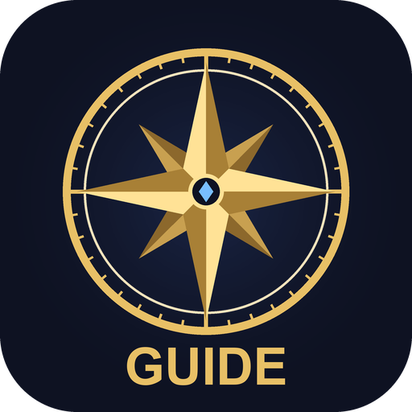

# OTSFFXIVGuide



Плагин [Dalamud](https://github.com/goatcorp/Dalamud) для FINAL FANTASY XIV: большой справочник прямо в игре.
Сюжет и квесты, данжи с механиками боссов и лутом, вики (предметы, бестиарий, зоны, NPC), экипировка,
дейлики и таймеры, погода Эорзеи, Gold Saucer, реликвии, коллекции, цены рынка — с русскими названиями и поиском по-русски.

> **Только информация.** Плагин ничего не нажимает и не делает за игрока — только читает данные и показывает их.

*An in-game encyclopedia plugin for FFXIV (Dalamud). UI is in Russian; item/mob/quest names can be shown in English, Russian or both.*

## Установка

1. В игре открой `/xlsettings` → **Экспериментальное** → **Сторонние репозитории плагинов**.
2. Добавь адрес:
   ```
   https://raw.githubusercontent.com/OTTYSS/OTSFFXIVGuide/main/repo.json
   ```
3. Сохрани, открой `/xlplugins`, найди **OTSFFXIVGuide** и установи.
4. Открой справочник: `/fguide` или **Ctrl+Shift+G**. При первом запуске мастер предложит скачать офлайн-базу и включить русские названия.

## Разделы

| Раздел | Что внутри |
|---|---|
| **Обзор** | Настраиваемые плитки: сюжет, дейлики, персонаж, прогресс, таймеры, океан, событие, погода. |
| **Поиск** | Данжи, квесты, предметы, мобы и разделы плагина — по-английски или по-русски. |
| **Сюжет и квесты** | Текущий сюжетный квест с флагом, главы, квесты-анлоки, что сделать дальше по цепочке, награды. |
| **Бои** | Данжи, триалы и рейды: как открыть, механики 200 боссов с подсказками по ролям, лут по боссам; разбор боёв; Deep Dungeons; реликвии всех дополнений по шагам, Eureka и Bozja; Occult Crescent (фантомные профессии, критические события, Forked Tower). |
| **Вики** | Предметы (все источники, где используется, дерево крафта, график цены, сравнение с надетым); бестиарий с фото; мебель и хаузинг; зоны (мобы, FATE, сбор, рыбалка, вистас, течения эфира, NPC); NPC; рыбалка и журнал рыбака; синий маг; профессии (все навыки, трейты, PvP, джоб-квесты); статусы (баффы и дебаффы, статусы цели); разборка (Desynthesis, Aetherial Reduction) и содержимое сундуков; избранное. |
| **Активности** | FATE и течения эфира, Hunt-марки, S-ранги (условия появления), левы, карты сокровищ, океаническая рыбалка (расписание), Gold Saucer (Mini Cactpot, Fashion Report, Triple Triad), Wondrous Tails с подсказками, окраска чокобо, садоводство (скрещивание семян), Island Sanctuary, племена, недельные лимиты рейдов (савадж, книги, томестоны), сезонные события и Custom Deliveries. |
| **Персонаж** | Экипировка с оценкой сета, BiS-сеты (Balance, xivgear, Etro) — что собрано, план сбора за томестоны и книги, материя и расходники в список покупок, фарм маунтов и минёнов, материя/еда/зелья, прокачка и навыки, достижения (в т.ч. почти выполненные), дневник прогресса, коллекции, разблокировки (эмоции, причёски, барды…), гламур. |
| **Экономика** | Все валюты (сколько есть, потолок, что выгоднее купить), разбор инвентаря (сумки, броне-шкаф, седельная сумка, ретейнеры), список покупок с ценами по миру, крафт, сбор, коллекционные за скрипы, субмарины и дирижабли, выгодные вылазки ретейнеров и апгрейд их экипировки. |
| **Время** | Дейлики и викли, таймеры (ретейнеры, субмарины, сбросы, Cactpot, Fashion Report), время и погода Эорзеи с напоминаниями. |

### В игре

- **Мини-окно** поверх игры с выбранными блоками (`/fguide mini`).
- **Цель:** выделил моба — фото, уровень и дроп в мини-окне (`/fguide target`).
- **Подсказка на предмете:** наведи на предмет с Shift — где взять, на что меняется, цена (`/fguide peek`).
- **Подсветка** выбранного предмета в сумках, броне-шкафу, седельной сумке и у ретейнера.
- **Метки на карте** зоны: вистас, течения эфира, точки сбора, рыбалка, FATE (настраиваются).
- **Окно механик** само открывается в данже и подсказывает, что делать на касте босса.
- **Уведомления** (чат или всплывающие): погода, ретейнеры, субмарины, снос дома, новое событие.

### Горячие клавиши в окне

`Ctrl+F` — поиск · `Alt+←/→` — назад/вперёд по вики · `Ctrl+1…0` — разделы меню. Правый клик по вкладке — закрепить её в меню.

## Офлайн-база и русские названия

- **Настройки → База данных → «Скачать всё»** (~45 МБ): открытые файлы [Teamcraft](https://github.com/ffxiv-teamcraft/ffxiv-teamcraft) и индексы [Garland Tools](https://www.garlandtools.org). «Обновить» докачивает только изменившиеся файлы. Garland Tools по желанию дополняет базу онлайн (дроп мобов, лут по боссам).
- **Русские названия**: машинный перевод (Google) названий предметов, мобов, NPC, квестов, данжей, зон и FATE — в фоне, с паузами. Режимы: английские / русские / «русское (English)». Свой словарь терминов применяется поверх перевода.

## Сборка

Нужны .NET 10 SDK и установленный XIVLauncher с Dalamud (или распакованный `dalamud-distrib` в `%AppData%\XIVLauncher\addon\Hooks\dev`).

```
dotnet build FFXIVGuide/OTSFFXIVGuide.csproj -c Release
```

Готовый пакет: `FFXIVGuide/bin/Release/OTSFFXIVGuide/latest.zip`. Для разработки добавь `FFXIVGuide/bin/Release/OTSFFXIVGuide.dll` в `/xlsettings` → **Экспериментальное** → **Пути к dev-плагинам**.

GitHub Actions собирает плагин на каждый push, а на тег `v*` (например, `v2.6.0`) публикует релиз с `latest.zip` — на него ссылается `repo.json`.

## Источники данных

- Файлы игры — через Lumina (Dalamud).
- [Teamcraft](https://github.com/ffxiv-teamcraft/ffxiv-teamcraft) (MIT) и [Garland Tools](https://www.garlandtools.org) — источники предметов, мобы, NPC, рыбалка (скачиваются пользователем).
- [Universalis](https://universalis.app) — цены рынка и история продаж.
- [FFXIV ConsoleGamesWiki](https://ffxiv.consolegameswiki.com) — механики боссов и шаги реликвий (CC BY-NC-SA 3.0); фото мобов загружаются оттуда же.
- Расписание океанической рыбалки — по формуле [Lulu's Tools](https://ffxiv.pf-n.co/ocean-fishing/about), сверено с таблицей маршрутов игры.

## Лицензия

Код — [MIT](LICENSE). Данные механик и реликвий основаны на ConsoleGamesWiki и распространяются по её лицензии.
FINAL FANTASY XIV © SQUARE ENIX CO., LTD. Плагин не связан с Square Enix.
